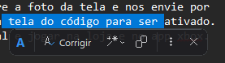
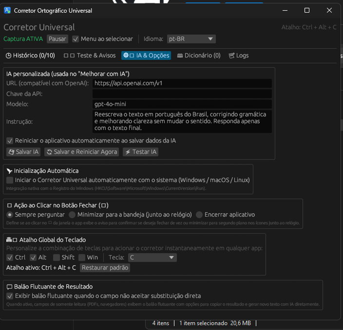

# Corretor Ortográfico Universal (Rust)

<p align="left">
  <a href="https://www.paypal.com/donate/?hosted_button_id=HW9QS2TXX9ZYQ"></a>
  &nbsp;
  <a href="https://livepix.gg/tudoxbox"></a>
  &nbsp;
  
  &nbsp;
  
</p>

> **Projeto 100% Gratuito e de Código Aberto (Open Source - Licença MIT)**  
> 🤖 **Desenvolvido com o auxílio de Inteligência Artificial (IA)**.  
> ✨ Sinta-se livre para usar, estudar, modificar e compartilhar como e onde quiser!  
> 💧 **Novo visual**: barra flutuante translúcida estilo gota d'água / pílula (*Apple Liquid Glass*), com reflexo especular, ícones nítidos e detecção inteligente que dispara **apenas** quando houver texto realmente selecionado.

---

## 🎯 Para que serve o aplicativo? / What is this app for?

### 🇧🇷 Em Português (PT-BR)

O **Corretor Ortográfico Universal** é um assistente de produtividade para todo o sistema que traz **correção ortográfica, gramatical e aprimoramento de texto com Inteligência Artificial para qualquer aplicativo do seu computador** (Windows, macOS e Linux).

#### 💡 Qual problema ele resolve?
Na maioria dos sistemas operacionais, a correção ortográfica é fragmentada: funciona em alguns programas e não funciona em outros. Muitas vezes você precisa abrir o navegador, acessar um site de correção ou chat de IA, colar o texto, aguardar, copiar de volta e colar no seu programa.

O **Corretor Universal elimina essa fricção**: ele fica ativo silenciosamente em segundo plano (junto ao relógio do sistema) e funciona de maneira global e transparente em:
* 💬 **Mensageiros**: WhatsApp Desktop, Telegram, Discord, Slack, Microsoft Teams
* 🌐 **Navegadores**: Google Chrome, Microsoft Edge, Mozilla Firefox, Brave, Opera
* 📝 **Editores e Notas**: Microsoft Word, Notion, Obsidian, Bloco de Notas, LibreOffice
* 💻 **Desenvolvimento**: Visual Studio Code, IDEs JetBrains, terminais
* 📧 **E-mails**: Outlook, Thunderbird, webmails

#### 🚀 Principais Utilidades:
1. **Correção Direta no Lugar (In-Place)**: Selecione o texto e clique em **A✓ Corrigir** (ou pressione o atalho global `Ctrl+Alt+C`). O texto é corrigido instantaneamente no próprio campo, sem necessidade de recortar ou colar manualmente.
2. **Reescrita e Tom com IA**: Melhore a clareza, torne o tom mais formal, simplifique ou encurte frases através do menu da varinha mágica (**🪄**). Compatível com OpenAI, Ollama (modelos 100% locais/offline), Groq, Gemini e qualquer provedor compatível.
3. **Sem Roubar o Foco**: A barra surge suavemente ao lado do cursor do mouse e executa as ações mantendo o foco da sua janela e cursor originais intactos.
4. **Suporte a Áreas de Leitura (PDFs e Sites)**: Quando um campo não é editável, o resultado é exibido em um balão escuro com botão para copiar a resposta com 1 clique.
5. **Dicionário Pessoal e Histórico**: Proteja termos técnicos, gírias e nomes próprios com um clique, e consulte facilmente suas últimas 10 correções.

---

### 🇺🇸 In English

The **Universal Spellchecker** is a lightweight, system-wide productivity assistant that brings **instant grammar proofreading, spellchecking, and AI-powered text transformation to every application on your computer** (Windows, macOS, and Linux).

#### 💡 What problem does it solve?
Desktop spellchecking is notoriously fragmented: it exists in some applications but is completely absent in others. Users constantly waste time switching windows, navigating to an online proofreader or AI website, pasting text, waiting, copying the result, and pasting it back into their work.

**Universal Spellchecker removes this friction entirely**: running silently in your system tray (next to the clock), it provides seamless, global integration across:
* 💬 **Messaging Apps**: WhatsApp Desktop, Telegram, Discord, Slack, Microsoft Teams
* 🌐 **Web Browsers**: Google Chrome, Microsoft Edge, Mozilla Firefox, Brave, Opera
* 📝 **Notes & Office**: Microsoft Word, Notion, Obsidian, Notepad, LibreOffice
* 💻 **Dev Environments**: Visual Studio Code, JetBrains IDEs, terminals
* 📧 **Email Clients**: Outlook, Thunderbird, and webmail clients

#### 🚀 Key Features & Capabilities:
1. **Instant In-Place Text Replacement**: Select any text and click **A✓ Corrigir** (or press the global hotkey `Ctrl+Alt+C` / `Cmd+Opt+C`). Your text is corrected directly inside the target field without manual clipboard juggling.
2. **AI Text Rewriting & Tone**: Enhance clarity, adjust tone to formal, simplify, or shorten messages using the Magic Wand menu (**🪄**). Works with OpenAI, Ollama (100% private offline local models), Groq, Gemini, or any OpenAI-compatible API.
3. **Zero Focus Stealing**: The modern Apple Aqua / Liquid Glass floating action bar appears gently near your cursor without stealing keyboard or window focus from your active app.
4. **Read-Only / PDF Support**: For uneditable fields (PDF viewers, web articles), results appear in a sleek floating pop-up card with 1-click copy.
5. **Custom Dictionary & History**: Whitelist technical terms, code keywords, and proper names, and review your 10 most recent corrections anytime.

---

## 🖼️ Capturas de Tela do Aplicativo (Screenshots)

| 🪄 Barra Flutuante em Ação (Texto Selecionado) | ⚙️ Janela Principal (Configurações, IA e Opções) |
| :---: | :---: |
|  |  |

---

## Como usar a barra flutuante

Selecione um texto (arrastando o mouse ou dando duplo clique numa palavra) e uma **barra de ações aparece sozinha**
no cursor, com acabamento nativo elegante (ícones em vetor, tipografia límpida, separadores sutis,
botão de cópia, menu de varinha mágica para IA, "⋮" e "✕"):

<p align="center">
  
</p>

```
[ A ] │ [ A✓ Corrigir ]  [ 🪄 ⌄ ]  [ ❐ ] │ [ ⋮ ]  [ ✕ ]
```

| Botão | O que faz |
| --- | --- |
| **A** | Marca do aplicativo em azul ciano limpo nativo. |
| **A✓ Corrigir** | Ortografia/gramática pelo LanguageTool (com fallback inteligente para IA se a API oscilar). Campo editável → substitui a seleção no lugar; campo travado → balão escuro com o resultado. |
| **🪄 ⌄** | Menu compacto de IA (varinha mágica): *Clareza e gramática*, *Mais formal*, *Mais simples*, *Mais curto*. |
| **❐ Copiar** (só o ícone) | Copia a seleção como está, sem chamar API/IA. |
| **⋮** | Flyout: *Revisar avisos na janela…*, *Histórico de correções (10 recentes)*, *Configurações do app*, *Adicionar seleção ao dicionário*, *Pausar a captura*, *Sair*. |
| **✕** | Fecha a barra (o mesmo que `Esc` ou clicar fora). |

A barra **não rouba o foco**: o clique em "Corrigir" cola no campo onde você
estava, e não no popup (as janelas são criadas com `WS_EX_NOACTIVATE`).

## Novidades e Recursos Recentes

* 🖱️ **Detecção no Botão Direito & Menu de Contexto do Navegador**:
  * **App Desktop**: Ao selecionar texto e soltar o clique com o **botão direito**, o app detecta e abre/reposiciona a barra flutuante ou balão próximo ao cursor em qualquer programa.
  * **Extensão para Chrome / Edge / Brave / Opera**: Pasta [`extension/`](extension/) pronta para carregar no navegador (`chrome://extensions`), adicionando as opções do app (*A✓ Corrigir seleção*, *🪄 Melhorar com IA*, *Tornar mais formal/simples/curto* e *Copiar*) diretamente dentro do menu nativo de clique direito. Comunicação bidirecional com o app via API local (`127.0.0.1:23456`) e suporte a fallback independente.
* ⌨️ **Atalho Global do Teclado 100% Personalizável**:
  * Escolha qualquer combinação de modificadores (`Ctrl`, `Alt/Option`, `Shift`, `Win/Cmd`) e teclas (`A-Z`, `0-9`, `F1-F12`, `Space`) diretamente na aba *Configurações*.
  * O registro no sistema é atualizado instantaneamente sem necessidade de reiniciar o aplicativo. Botão para restaurar o padrão (`Ctrl+Alt+C` ou `Cmd+Alt+C`).
* 💬 **Balão Flutuante Configurável com Suporte a IA**:
  * **Ativar/Desativar**: Opção para habilitar ou desabilitar a exibição do balão flutuante quando o campo não aceitar substituição direta.
  * **✨ Gerar Novo Texto com IA no Balão**: Botão dedicado diretamente na janela do balão (*"Gerar novo texto com IA"*) para reescrever o resultado no estilo e prompt configurados, copiando para a área de transferência e salvando no histórico.
* 🚀 **Inicialização Automática com o Sistema (Windows, macOS e Linux)**:
  * **Windows**: Integração nativa com o Registro (`HKCU\Software\Microsoft\Windows\CurrentVersion\Run`), sem exigir permissões de administrador.
  * **macOS**: Integração automática com LaunchAgents (`~/Library/LaunchAgents/com.corretoruniversal.app.plist`).
  * **Linux**: Padrão oficial XDG Autostart (`~/.config/autostart/corretor_universal.desktop`).
  * Pode ser ativada/desativada tanto pela aba *⚙️ IA & Opções* quanto pelo menu de contexto da bandeja (*Iniciar com o sistema*).
* 🖼️ **Ícone Nativo Unificado de Alta Definição**:
  * O ícone translúcido Apple Aqua / gota d'água agora é renderizado em perfeita resolução (32x32 RGBA) em todos os pontos do sistema: executável `.exe`, bandeja da barra de tarefas (systray) e barra de título da janela do app.
* 🪟 **Design Nativo Compacto & Estável**: Barra em retângulo arredondado moderno (raio de 8px, altura de 34px) com contorno sutil de 1px, sem proporções exageradas de cápsula.
* ✍️ **Ícones Vetoriais Nativos de Alta Resolução**:
  * **A✓**: Símbolo clássico de verificação ortográfica (A com tique subscrito).
  * **🪄 ⌄**: Varinha mágica elegante com centelhas estilo IA e chevron compacto.
  * **❐**: Folhas de documento sobrepostas nativas com alinhamento ortogonal.
  * **⋮**: Três pontos verticais perfeitamente centralizados e dimensionados.
  * **✕**: Cruz fina, nítida e simétrica.
* 📜 **Histórico Persistente (10 recentes)**: Salva automaticamente as últimas 10 correções em `%APPDATA%\corretor_universal\historico.json`. Acompanhe original vs. corrigido, data/hora, tipo de motor (LanguageTool / IA) e copie facilmente.
* 🤖 **Fallback Automático para IA**: Se o serviço público LanguageTool estiver indisponível ou sofrer com limite de requisições, o motor recorre à sua IA configurada de modo transparente.
* 🪟 **Aviso de Confirmação ao Fechar (Fechar vs. Minimizar para o Relógio)**:
  * Ao clicar no botão fechar (`✕`) da janela, o app exibe uma janela de confirmação perguntando se você deseja realmente fechar/encerrar o aplicativo ou minimizá-lo para os ícones de segundo plano junto ao relógio (bandeja do sistema).
  * Opção de marcar *"Lembrar minha decisão"*, além de controle direto na aba *⚙️ IA & Opções* (Sempre perguntar, Minimizar para a bandeja ou Fechar de vez).
* 🎯 **Botão de Teste Visual**: Na aba *Teste e Avisos*, utilize o botão **`🎯 Testar Barra Flutuante Agora`** para abrir a barra instantaneamente na posição do mouse e inspecionar os ícones e efeitos de hover.

## Revisão aviso por aviso (como no LanguageTool)

A verificação devolve a **lista de avisos** com as alternativas que a própria API
ofereceu (nada de aplicar às cegas a primeira sugestão de tudo). Na janela do app:

| Controle | O que faz |
| --- | --- |
| **caixa de seleção** de cada aviso | marca/desmarca aquele aviso (desmarcado fica no texto) |
| **alternativas** (botões abaixo do aviso) | escolhe qual sugestão usar — a primeira é a que a API considera melhor |
| **Ignorar** | deixa este aviso fora, sem mexer no dicionário |
| **Dicionário** | protege a palavra (nunca mais corrigida) e desmarca o aviso |
| **Aplicar N aviso(s) e copiar o resultado** | monta o texto só com os avisos marcados e copia (não altera o campo de outro app) |
| **Verificar seleção** | roda de novo a verificação no texto selecionado no outro aplicativo |
| **Marcar todos / Limpar lista** | atalhos para a lista |

Cada aviso mostra também a regra, a categoria e a explicação da API, por exemplo
`MORFOLOGIK_RULE_PT_BR · TYPOS · Encontrado possível erro de ortografia.`

Quando a barra aparece, o app tenta pegar o texto **só pelo UI Automation** (sem
mexer na sua área de transferência) para já oferecer as alternativas na seta.
Sem texto pelo UIA, a lista completa sai pelo "Revisar avisos…" / "Verificar
seleção", que usa a captura normal (UI Automation e, se precisar, `Ctrl+C`).

Quando o campo **não é editável** (página web, PDF, mensagem recebida), nada é
colado: aparece um **balão** escuro com o resultado e o botão **Copiar resultado**
(que copia o resultado já obtido, sem refazer a consulta).

O app também fica **sempre ativo na bandeja** (ícone perto do relógio, menu
"Abrir / Captura ativa / Menu ao selecionar texto / Sair"). Ao clicar no botão
fechar (**✕**) da janela, o app exibe um **aviso** perguntando se você prefere
**minimizar para a bandeja** (ícones de segundo plano junto ao relógio) ou **fechar o app**
de verdade, com opção de salvar essa escolha.

O atalho global `Ctrl+Alt+C` (`Cmd+Alt+C` no macOS) continua funcionando e abre
a mesma barra.

## 📦 Downloads & Releases Prontos (Windows, Linux e macOS)

Os pacotes prontos para uso são gerados automaticamente via **GitHub Actions** em cada lançamento na aba [Releases](../../releases):

| Sistema Operacional | Arquivo | Como Usar |
| :--- | :--- | :--- |
| **🪟 Windows (64-bit) — portátil** | `corretor_universal-v*-windows-x86_64.zip` | Extraia e execute `corretor_universal.exe`. Não requer instalação. |
| **🪟 Windows (64-bit) — instalador** | `corretor_universal-v*-windows-x86_64.msi` | Instalador MSI (Windows Installer): instala em `Arquivos de Programas`, cria atalhos no Menu Iniciar/Área de Trabalho e permite desinstalar pelo Painel de Controle. |
| **🐧 Linux (x86_64)** | `corretor_universal-v*-linux-x86_64.tar.gz` | Extraia e rode `./install.sh` para integrar ao menu de aplicativos e PATH. |
| **🍎 macOS (Universal)** | `corretor_universal-v*-macos-universal.zip` | Extraia e arraste `Corretor Universal.app` para `Aplicativos`. Roda nativo no Apple Silicon (M1/M2/M3/M4) e Intel. |

### 🚀 Como Criar e Publicar um Novo Release no GitHub

O projeto conta com uma esteira de CI/CD completa configurada em `.github/workflows/release.yml`:

1. **Via Tag no Git**:
   ```bash
   git tag v0.1.0
   git push origin v0.1.0
   ```
2. **Via Interface do GitHub**:
   * Acesse a aba **Actions** no seu repositório.
   * Selecione o workflow **Build & Release Multi-Plataforma**.
   * Clique em **Run workflow**, digite a versão desejada (ex: `v0.1.0`) e confirme.
    * O GitHub Actions compilará os binários em máquinas reais Windows, Ubuntu e macOS, empacotando e criando o Release automaticamente com os arquivos `.zip`, `.msi`, `.tar.gz` e checksums SHA256.

3. **Gerar pacote local no Windows**:
   * Para gerar o zip de release localmente na sua máquina:
   ```powershell
   .\packaging\windows\build_release_zip.ps1 -Tag v0.1.0
   ```
   * O arquivo final pronto para upload será criado em `dist/corretor_universal-v0.1.0-windows-x86_64.zip`.
   * Para gerar o **instalador MSI** (requer o [WiX Toolset v7](https://wixtoolset.org/) — `winget install --id WiXToolset.WiXCLI -e`):
   ```powershell
   .\packaging\windows\build_msi.ps1 -Tag v0.1.0
   ```
   * O instalador será criado em `dist/corretor_universal-v0.1.0-windows-x86_64.msi`.

## Build e Execução (Manual / Código Fonte)

### 🧪 Executar Rapidamente em Modo de Teste / Desenvolvimento (Dev Mode)

Para testar ou desenvolver o aplicativo com **todos os logs visíveis no terminal** em tempo real (eventos de seleção com botão esquerdo e direito, requisições da extensão do navegador, chamadas de IA e diagnósticos):

```powershell
# Compilar e executar diretamente em modo dev (com console de logs aberto):
cargo run

# Ou utilize os scripts de atalho:
.\dev.ps1        # No PowerShell
dev.bat          # No Prompt de Comando / Duplo clique no Windows Explorer
```

Se preferir apenas gerar a build de teste sem executar imediatamente:
```powershell
cargo build
.\target\debug\corretor_universal.exe
```

> 💡 **Vantagem do Modo Dev**: No modo de desenvolvimento (`debug`), o terminal do Windows permanece aberto mostrando em tempo real o que o app está fazendo. Já no modo de produção (`cargo build --release`), o executável roda silencioso e invisível em segundo plano junto ao relógio do sistema.

---

### 1. Windows

O projeto no Windows suporta duas abordagens de compilação: **GNU (MinGW-w64)** ou **MSVC (Visual Studio)**.

#### Opção A: Ambiente GNU / MinGW-w64 portátil (sem Visual Studio)
Ideal para compilar sem precisar instalar o Visual Studio completo (~10 GB):

1. **Instalar o Rust com Toolchain GNU**:
   - Baixe o instalador oficial [rustup-init.exe](https://win.rustup.rs/x86_64).
   - Execute no PowerShell para instalar o toolchain GNU minimal:
     ```powershell
     .\rustup-init.exe -y --default-host x86_64-pc-windows-gnu --default-toolchain stable --profile minimal
     ```
2. **MinGW-w64 portátil (`w64devkit`)**:
   - Baixe a versão mais recente do [w64devkit](https://github.com/skeeto/w64devkit/releases).
   - Extraia a pasta `w64devkit` em `%USERPROFILE%\tools\w64devkit\w64devkit`.
3. **Shim do `libgcc_eh.a`**:
   - O w64devkit em 64-bit não distribui `libgcc_eh.a` avulso. Crie a pasta `%USERPROFILE%\tools\mingw-rust-shim` e gere o shim vazio:
     ```powershell
     New-Item -ItemType Directory -Path "$env:USERPROFILE\tools\mingw-rust-shim" -Force
     & "$env:USERPROFILE\tools\w64devkit\w64devkit\bin\x86_64-w64-mingw32-ar.exe" crs "$env:USERPROFILE\tools\mingw-rust-shim\libgcc_eh.a"
     ```
4. **Configuração do `.cargo/config.toml`**:
   - Mantenha o arquivo `.cargo/config.toml` com:
     ```toml
     [target.x86_64-pc-windows-gnu]
     linker = "x86_64-w64-mingw32-gcc"
     rustflags = ["-L", "C:\\Users\\<SEU_USUARIO>\\tools\\mingw-rust-shim"]
     ```
5. **Compilar (escolha uma das opções)**:
   - No **PowerShell**: `.\build.ps1`
   - No **Prompt de Comando / Duplo clique no Explorer**: `build.bat`
   - No **Git Bash**: `./build.sh`
   - Ou diretamente com Cargo:
     ```powershell
     $env:PATH = "$env:USERPROFILE\tools\w64devkit\w64devkit\bin;$env:USERPROFILE\.cargo\bin;$env:PATH"
     cargo build --release
     ```
6. **Executar**:
   ```powershell
   .\target\release\corretor_universal.exe
   ```

#### Opção B: MSVC (Visual Studio Build Tools)
Se você já possui o Visual Studio ou os Build Tools com C++ instalados:

1. **Configurar o toolchain MSVC**:
   ```powershell
   rustup default stable-x86_64-pc-windows-msvc
   ```
2. **Remover a personalização GNU**:
   - Exclua ou renomeie o arquivo `.cargo/config.toml`.
3. **Compilar**:
   ```powershell
   cargo build --release
   ```
4. **Executar**:
   ```powershell
   .\target\release\corretor_universal.exe
   ```

---

### 2. Linux (Ubuntu, Debian, Fedora, Arch)

No Linux, o app utiliza X11/OpenGL e a API pública do LanguageTool. A detecção automática de cliques e UIA é específica do Windows; no Linux a interface abre e responde ao atalho global **`Ctrl + Alt + C`**.

#### Passo 1: Instalar Dependências de Sistema

- **Debian / Ubuntu / Linux Mint**:
  ```bash
  sudo apt update
  sudo apt install -y build-essential pkg-config libssl-dev \
      libx11-dev libxext-dev libxft-dev libxinerama-dev \
      libxcursor-dev libxi-dev libxrandr-dev libxss-dev libgl1-mesa-dev
  ```

- **Fedora / RHEL**:
  ```bash
  sudo dnf install -y gcc pkgconf-pkg-config openssl-devel \
      libX11-devel libXcursor-devel libXrandr-devel libXi-devel mesa-libGL-devel
  ```

- **Arch Linux / Manjaro**:
  ```bash
  sudo pacman -S --needed base-devel openssl libx11 libxcursor libxrandr libxi mesa pkgconf
  ```

#### Passo 2: Instalar o Rust
```bash
curl --proto '=https' --tlsv1.2 -sSf https://sh.rustup.rs | sh
source "$HOME/.cargo/env"
```

#### Passo 3: Compilar e Rodar
Certifique-se de que o arquivo `.cargo/config.toml` (específico para Windows GNU) não interfira no build do Linux. O Cargo ignora o alvo `x86_64-pc-windows-gnu` automaticamente no Linux.

```bash
cargo build --release
./target/release/corretor_universal
```

> **Dica Wayland**: Se utilizar ambientes como GNOME/KDE sob Wayland nativo e o atalho global não disparar, execute com XWayland ou configure o atalho de teclado global do próprio ambiente chamando `./target/release/corretor_universal`.

---

### 3. macOS (Apple Silicon M1/M2/M3/M4 & Intel)

No macOS, o atalho global padrão é **`Cmd + Option + C`** (ou `Ctrl + Alt + C`).

#### Passo 1: Instalar Xcode Command Line Tools
Abra o Terminal e execute:
```bash
xcode-select --install
```

#### Passo 2: Instalar o Rust
```bash
curl --proto '=https' --tlsv1.2 -sSf https://sh.rustup.rs | sh
source "$HOME/.cargo/env"
```

#### Passo 3: Compilar
```bash
cargo build --release
```

#### Passo 4: Conceder Permissões de Acessibilidade
Para que o atalho global funcione entre aplicativos no macOS:
1. Abra **Ajustes do Sistema** (System Settings).
2. Vá em **Privacidade e Segurança > Acessibilidade** (Privacy & Security > Accessibility).
3. Habilite o **Terminal** (ou o executável compilado).

#### Passo 5: Executar
```bash
./target/release/corretor_universal
```

---

## Modos de linha de comando (verificação)

```bash
# correção (LanguageTool): texto, idioma, palavras ignoradas
./target/release/corretor_universal.exe --self-test "Eu gosto de programaçao." pt-BR "rust"

# IA personalizada, opcionalmente sobrescrevendo a configuração
./target/release/corretor_universal.exe --ia-test "texto" --url http://127.0.0.1:8137/v1 \
    --chave K --modelo M

# o que o app enxerga no campo com foco (diagnóstico da detecção automática)
./target/release/corretor_universal.exe --uia-test
```

## Configuração

`%APPDATA%\corretor_universal\config.json` (macOS:
`~/Library/Application Support/corretor_universal/`, Linux:
`~/.config/corretor_universal/`):

```json
{
  "idioma": "pt-BR",
  "ativo": true,
  "deteccao_automatica": true,
  "iniciar_com_sistema": true,
  "balao_ativo": true,
  "acao_ao_fechar": "perguntar",
  "atalho": {
    "ctrl": true,
    "alt": true,
    "shift": false,
    "meta": false,
    "tecla": "C"
  },
  "dicionario": ["rust"],
  "ia_url": "https://api.openai.com/v1",
  "ia_chave": "sua-chave",
  "ia_modelo": "gpt-4o-mini",
  "ia_prompt": "Reescreva o texto em português do Brasil..."
}
```

`ia_url` aceita a base (`.../v1`) ou a URL completa (`.../v1/chat/completions`).
Qualquer provedor compatível com OpenAI serve (OpenAI, Groq, Gemini via
endpoint compatível, OpenRouter, um modelo local com Ollama/LM Studio etc.).
A chave fica **em texto puro** no arquivo — cuide das permissões dele.

## Verificação feita neste projeto

Harnesses em `tools/` (com o app aberto e o Windows desbloqueado; não use o
mouse/teclado durante o teste):

| Comando | Verifica |
| --- | --- |
| `python tools/e2e_menu.py` | arrasta o mouse para selecionar → barra aparece com os 5 botões → clique em **Corrigir** → seleção substituída, foco nunca sai da janela |
| `python tools/e2e_menu.py --atalho` | o mesmo pelo atalho `Ctrl+Alt+C` |
| `python tools/e2e_menu.py --pela-seta` | seta do **Corrigir** abre o flyout → *Apenas copiar a correção* → corrige sem mexer no campo |
| `python tools/e2e_menu.py --copiar` | botão **⧉** copia a seleção exatamente como está |
| `python tools/e2e_menu.py "palavra" --dicionario` | **⋮ → Adicionar seleção ao dicionário**: a palavra entra no `config.json` e o texto não é tocado (restaure a configuração depois) |
| `python tools/e2e_menu.py --melhorar` | **Melhorar com IA** (use o mock abaixo para não gastar créditos) |
| `python tools/e2e_menu.py --melhorar-formal` | **Melhorar ▾ → Mais formal**: confere no log do mock que a IA recebeu o prompt da variante |
| `python tools/e2e_menu.py --sugestao=N` | a seta do **Corrigir** lista as alternativas reais e aplicar a N-ésima corrige **só** aquele trecho (o outro erro do texto tem de continuar lá) |
| `python tools/e2e_menu.py --revisar` | **Corrigir ▾ → Revisar avisos…** abre a janela com a lista |
| `corretor_universal.exe --analise-test "texto"` | imprime a análise (avisos, alternativas, regra, categoria, mensagem) sem abrir a janela |
| `python tools/e2e_menu.py --somente-leitura` | campo não editável: balão com resultado, botão **Copiar resultado** funcionando, campo intacto |
| `python tools/e2e_barra.py [--pausar]` | estrutura da barra (5 botões na mesma linha), flyout do Corrigir, flyout do ⋮, o **✕** fecha; `--pausar` testa *⋮ → Pausar a captura* de verdade |
| `python tools/e2e_barra.py --acao abrir` | **⋮ → Abrir o app** mostra a janela principal |
| `python tools/e2e_barra.py --acao sair` | **⋮ → Sair** encerra o processo (rode por último) |
| `python tools/captura_barra.py` | fotografa a barra (salva `tools/barra_exemplo.png`) e confere no pixel: fundo escuro `RGB(30,30,32)`, marca em azul, texto claro, cantos arredondados |
| `python tools/e2e_tray.py` | fechar a janela → continua ativo na bandeja (ícone no registro da área de notificação) |

`e2e_barra.py` e `captura_barra.py` **não** precisam que a janela de destino
esteja em primeiro plano (usam o atalho global), então servem para conferir a
barra mesmo com outra janela na frente.

Resultados medidos nesta máquina: substituição no lugar em **~1,4 s**; barra de
**477x40 px** com os 5 botões; o menu abre sem tirar o foco (a janela de destino
segue em primeiro plano depois do clique no botão); com a janela escondida na
bandeja o motor continua funcionando (mesmo teste de menu passa).

Um mock compatível com OpenAI para testar a IA sem chave real:

```bash
python tools/mock_ia.py 8137            # responde em http://127.0.0.1:8137/v1
```

## Limitações conhecidas

- **Detecção automática só no Windows** (usa UI Automation + mouse nativo). No
  macOS/Linux o atalho global funciona, mas não há barra nativa: a ação é
  executada direto e o resultado aparece na janela do app.
- As **ações extras** (setas/flyouts, ⋮, ✕) existem só na barra; no macOS/Linux,
  que não têm barra nativa, o atalho faz apenas a correção direta.
- **"Adicionar seleção ao dicionário"** aceita só **uma palavra** por vez
  (o dicionário protege palavras soltas; um trecho inteiro não teria sentido).
- Detecta seleção feita com o **mouse** (arrasto ou clique duplo). Seleção por
  teclado (`Shift+setas`, `Ctrl+A`) não abre o menu — use o atalho.
- **Falsos positivos**: `Rust` continua sendo marcado como erro de ortografia e o
  botão "Corrigir" aplica **todos os avisos marcados** (inclusive de estilo), então
  `Rust` ainda vira `Rush` nesse clique. Agora dá para resolver de três formas:
  desmarcar o aviso na lista, clicar em **Dicionário** (nunca mais corrigir a
  palavra) ou usar a seta (**Só isto: …**) para aplicar apenas o que interessa.
- A análise automática ao selecionar usa **só UI Automation**; em campos que não
  expõem texto por UIA a seta mostra *Abrir a lista de avisos…* e a verificação
  sai quando você clica (aí sim com `Ctrl+C`).
- A API pública do LanguageTool limita a **20 KB por requisição, 20 req/min** e
  pede para não automatizar requisições em massa; textos maiores voltam HTTP 413 e
  ainda não são fatiados por frases.
- **Clipboard**: depois de aplicar no campo, a área de transferência fica com o
  texto final (o conteúdo anterior não é restaurado). No caminho do balão o
  conteúdo anterior é preservado até você clicar em "Copiar resultado".
- Os flyouts são janelas próprias (mesmo tema escuro da barra), abertos pela
  seta/"⋮"; eles fecham com `Esc`, clique fora, `✕` ou depois de 12 s.
- **Falha da API sem retry**: se a requisição ao LanguageTool falhar (timeout de
  6 s, HTTP 429), aparece no histórico e nada é aplicado.
- **Campos que não expõem UI Automation** (alguns apps legados, telas
  desenhadas à mão) não acionam o menu nem a checagem de editabilidade — nesses
  casos o atalho ainda tenta corrigir e colar.
- Uso de memória: ~75–135 MB de working set (egui/glow + OpenGL), bem acima dos
  15 MB citados no projeto original.

---

## 💖 Apoie o Projeto / Donations & Support

Este projeto é **100% gratuito e de código aberto (Open Source)**. Se o aplicativo tem sido útil para economizar seu tempo, aprimorar seus textos e agilizar seu fluxo de trabalho no dia a dia, você pode apoiar financeiramente a manutenção e criação de novos recursos com uma doação voluntária de qualquer valor!

*This project is **100% free and open-source**. If it saves you time and improves your daily writing, consider supporting its continuous maintenance and features with a voluntary donation!*

<div align="center">

<br/>

<a href="https://www.paypal.com/donate/?hosted_button_id=HW9QS2TXX9ZYQ" target="_blank">
  
</a>
&nbsp;&nbsp;&nbsp;&nbsp;
<a href="https://livepix.gg/tudoxbox" target="_blank">
  
</a>

<br/><br/>

### 📱 Escaneie o QR Code do PayPal para Doar:

<a href="https://www.paypal.com/donate/?hosted_button_id=HW9QS2TXX9ZYQ" target="_blank">
  
</a>

<br/><br/>

| Método / Plataforma | Link de Doação |
| :--- | :--- |
| 💳 **PayPal** | [https://www.paypal.com/donate/?hosted_button_id=HW9QS2TXX9ZYQ](https://www.paypal.com/donate/?hosted_button_id=HW9QS2TXX9ZYQ) |
| ⚡ **Livepix (Pix Instantâneo)** | [https://livepix.gg/tudoxbox](https://livepix.gg/tudoxbox) |

<br/>

**Muito obrigado pelo seu apoio! / Thank you very much for your support!** ❤️

</div>

